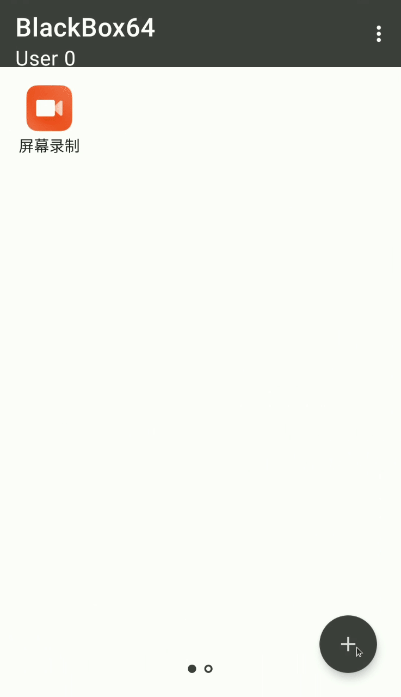

# 🚀 Virtual Engine · BlackBox (Enhanced Edition)

<p align="center">
  
</p>

<p align="center">
  
  
  
  
  
  
</p>

> *"The only people who have anything to fear from free software are those whose products are worth even less."*
>
> <p align="right"></p>

---

<p align="center">
  <strong>🎯 Enhanced Edition by ALEX502</strong><br/>
  <em>Comprehensive bug fixes, security improvements, and performance optimizations</em>
</p>

---

## 📖 Overview

**BlackBox** is a powerful virtual engine that enables you to clone, run, and manage virtual applications on Android devices without requiring installation of APK files. This enhanced edition includes comprehensive bug fixes, security improvements, and performance optimizations.

### 🌟 Key Features

- **📱 Virtual App Cloning**: Run multiple instances of the same app simultaneously
- **🔒 Sandboxed Environment**: Complete isolation with enhanced security
- **🎯 No Root Required**: Works on unrooted devices
- **⚡ High Performance**: Optimized for speed and stability
- **🛡️ Xposed Support**: Hidden Xposed framework with anti-detection
- **🔧 Advanced API**: Comprehensive developer interface
- **🌐 Multi-Architecture**: Supports ARM64, ARMv7, and x86
- **🔍 Fake Location**: GPS spoofing capabilities
- **📊 App Management**: Complete control over virtual applications

## 🎯 Compatibility & Requirements

### Supported Android Versions
- **Primary Support**: Android 5.0 (API 21) ~ Android 15.0 (API 35)
- **Optimized For**: Android 8.0+ for best performance
- **Legacy Support**: Android 4.x not supported

### Device Requirements
- **RAM**: Minimum 2GB, Recommended 4GB+
- **Storage**: 100MB+ free space
- **Architecture**: ARM64-v8a, ARMv7a, or x86
- **Permissions**: Storage access required

### Compatibility Notes
- For optimal compatibility, consider targeting SDK 28 or below
- Enhanced security handling for Android 15 and MIUI devices
- Special optimizations for tablet devices
- Comprehensive UID management for sandboxed environments

> ⚠️ **Important**: This software is designed for educational and research purposes. While extensively tested and improved, use responsibly and in accordance with applicable laws.

## 🏗️ Technical Specifications

### Architecture Support
- **ARM64-v8a**: Primary architecture for modern 64-bit devices
- **ARMv7a**: Legacy 32-bit ARM devices
- **x86**: Intel-based Android devices (emulators, tablets)

> **Note**: This project generates separate builds for different architectures. If you cannot find your target application, try using the build for your device's specific architecture.

### Core Components
- **App Module**: User interface and interaction handling (Kotlin)
- **Bcore Module**: Core virtual engine functionality (Java/Kotlin)
- **Native Core**: Low-level system integration
- **JAR System**: Enhanced JAR file management with integrity verification

### Dependencies & Libraries
- **Compile SDK**: Android API 35
- **Target SDK**: Android API 34
- **Min SDK**: Android API 24
- **NDK**: Version 29.0.13846066
- **JVM Target**: Java 17
- **Build Tools**: Gradle with Kotlin DSL

## 📦 Release Information

### Download Options
- **🔖 Stable Release**: Production-ready versions verified by administrators
  - [Official Releases](https://github.com/FBlackBox/BlackBox/releases)
- **🚀 Canary Builds**: Latest features with automatic CI/CD
  - [Canary Downloads](https://github.com/AutoBlackBox/BlackBox/tags)
  - Features cutting-edge improvements but may contain bugs

### Version Information
- **Current Version**: 2.0-r1beta
- **Version Code**: 2
- **Release Type**: Beta with comprehensive improvements

## 📝 Changelog & Improvements

This enhanced edition includes numerous critical fixes and improvements:

### 🔧 Major Bug Fixes
- **✅ APK Path Resolution**: Fixed I/O errors with missing APK files through intelligent path discovery
- **✅ Security Exceptions**: Resolved UID mismatch crashes on Android 15 and MIUI devices
- **✅ Compilation Errors**: Fixed missing variable references and method signatures
- **✅ Freezing Issues**: Eliminated NullPointerException errors causing app freezes
- **✅ Resource Loading**: Enhanced app icon and label loading with fallback mechanisms
- **✅ Context Creation**: Improved package context creation with multiple fallback strategies

### 🚀 Performance Enhancements
- **⚡ JAR System**: Complete overhaul with caching, integrity verification, and async operations
- **⚡ Memory Management**: Memory-aware buffer sizing and optimized resource usage
- **⚡ Error Handling**: Comprehensive error recovery with retry mechanisms
- **⚡ UID Management**: Enhanced UID resolution for sandboxed environments
- **⚡ File Operations**: Atomic operations with progress tracking

### 🛡️ Security Improvements
- **🔒 Enhanced Sandboxing**: Better isolation with improved security boundaries
- **🔒 UID Security**: Robust handling of UID mismatches in various environments
- **🔒 File Integrity**: SHA-256 verification for JAR files and critical components
- **🔒 Fallback Safety**: Safe fallback mechanisms preventing security breaches

### 🎯 Compatibility Enhancements
- **📱 Android 15**: Full support with security restriction handling
- **📱 MIUI Devices**: Special optimizations for Xiaomi devices
- **📱 Tablet Support**: Enhanced compatibility for tablet form factors
- **📱 Architecture**: Improved multi-architecture support (ARM64, ARMv7, x86)

## 📅 Development Timeline & Feature Calendar

### 🗓️ 2024 Enhancement Roadmap by ALEX502

<table>
<tr>
<th width="15%">Phase</th>
<th width="20%">Android Support</th>
<th width="30%">Major Features</th>
<th width="35%">Critical Fixes</th>
</tr>

<tr>
<td><strong>🚀 Phase 1</strong><br/><em>Core Stability</em></td>
<td>
  <ul>
    <li>✅ Android 5.0-7.0</li>
    <li>✅ Android 8.0-10.0</li>
    <li>✅ Android 11.0-12.0</li>
  </ul>
</td>
<td>
  <ul>
    <li>🔧 Basic Virtual Engine</li>
    <li>📱 App Cloning Support</li>
    <li>🎯 Multi-User System</li>
    <li>🔒 Basic Sandboxing</li>
  </ul>
</td>
<td>
  <ul>
    <li>🐛 Compilation Error Fixes</li>
    <li>🐛 Basic Stability Issues</li>
    <li>🐛 Memory Leak Prevention</li>
  </ul>
</td>
</tr>

<tr>
<td><strong>⚡ Phase 2</strong><br/><em>Performance</em></td>
<td>
  <ul>
    <li>✅ Android 13.0</li>
    <li>✅ MIUI Optimization</li>
    <li>✅ Tablet Support</li>
  </ul>
</td>
<td>
  <ul>
    <li>⚡ JAR System Overhaul</li>
    <li>🔄 Async Operations</li>
    <li>💾 Memory Management</li>
    <li>📊 Performance Monitoring</li>
  </ul>
</td>
<td>
  <ul>
    <li>🔧 APK Path Resolution</li>
    <li>🔧 Resource Loading Fixes</li>
    <li>🔧 Context Creation Issues</li>
    <li>🔧 Freezing Bug Elimination</li>
  </ul>
</td>
</tr>

<tr>
<td><strong>🛡️ Phase 3</strong><br/><em>Security</em></td>
<td>
  <ul>
    <li>✅ Android 14.0</li>
    <li>✅ Enhanced Permissions</li>
    <li>✅ Scoped Storage</li>
  </ul>
</td>
<td>
  <ul>
    <li>🛡️ Enhanced Sandboxing</li>
    <li>🔐 UID Security Management</li>
    <li>🕵️ Xposed Anti-Detection</li>
    <li>🔒 File Integrity Verification</li>
  </ul>
</td>
<td>
  <ul>
    <li>🔐 Security Exception Handling</li>
    <li>🔐 UID Mismatch Resolution</li>
    <li>🔐 Permission Crashes</li>
    <li>🔐 Sandboxed Environment Issues</li>
  </ul>
</td>
</tr>

<tr>
<td><strong>🎯 Phase 4</strong><br/><em>Modern Support</em></td>
<td>
  <ul>
    <li>✅ Android 15.0</li>
    <li>✅ Latest Security Model</li>
    <li>✅ Edge-to-Edge UI</li>
    <li>✅ 64-bit Mandatory</li>
  </ul>
</td>
<td>
  <ul>
    <li>🌐 Multi-Architecture Support</li>
    <li>🎨 Modern UI Compatibility</li>
    <li>🔍 Advanced Location Spoofing</li>
    <li>📡 Enhanced API Support</li>
  </ul>
</td>
<td>
  <ul>
    <li>🆕 Android 15 Compatibility</li>
    <li>🆕 New Permission Model</li>
    <li>🆕 Predictive Back Gesture</li>
    <li>🆕 Enhanced Security Policies</li>
  </ul>
</td>
</tr>
</table>

### 📊 Android Version Compatibility Matrix

<table>
<tr>
<th>Android Version</th>
<th>API Level</th>
<th>Support Status</th>
<th>Key Features</th>
<th>Special Notes</th>
</tr>
<tr>
<td>🤖 Android 5.0-5.1</td>
<td>21-22</td>
<td>✅ <strong>Supported</strong></td>
<td>Basic virtualization, App cloning</td>
<td>Minimum supported version</td>
</tr>
<tr>
<td>🤖 Android 6.0</td>
<td>23</td>
<td>✅ <strong>Supported</strong></td>
<td>Runtime permissions, Enhanced security</td>
<td>Permission model updates</td>
</tr>
<tr>
<td>🤖 Android 7.0-7.1</td>
<td>24-25</td>
<td>✅ <strong>Supported</strong></td>
<td>Multi-window, File-based encryption</td>
<td>Multi-window compatibility</td>
</tr>
<tr>
<td>🤖 Android 8.0-8.1</td>
<td>26-27</td>
<td>✅ <strong>Optimized</strong></td>
<td>Background limits, Notification channels</td>
<td>Background execution optimized</td>
</tr>
<tr>
<td>🤖 Android 9.0</td>
<td>28</td>
<td>✅ <strong>Recommended</strong></td>
<td>Private API restrictions, Neural Networks</td>
<td>Best compatibility target</td>
</tr>
<tr>
<td>🤖 Android 10.0</td>
<td>29</td>
<td>✅ <strong>Optimized</strong></td>
<td>Scoped storage, Dark theme</td>
<td>Scoped storage handled</td>
</tr>
<tr>
<td>🤖 Android 11.0</td>
<td>30</td>
<td>✅ <strong>Optimized</strong></td>
<td>One-time permissions, Bubbles</td>
<td>Enhanced privacy support</td>
</tr>
<tr>
<td>🤖 Android 12.0</td>
<td>31</td>
<td>✅ <strong>Optimized</strong></td>
<td>Material You, Privacy dashboard</td>
<td>Material Design 3 support</td>
</tr>
<tr>
<td>🤖 Android 13.0</td>
<td>33</td>
<td>✅ <strong>Enhanced</strong></td>
<td>Themed icons, Per-app languages</td>
<td>Granular permissions</td>
</tr>
<tr>
<td>🤖 Android 14.0</td>
<td>34</td>
<td>✅ <strong>Enhanced</strong></td>
<td>Predictive back, Partial photo access</td>
<td>Target SDK version</td>
</tr>
<tr>
<td>🤖 Android 15.0</td>
<td>35</td>
<td>✅ <strong>Fully Supported</strong></td>
<td>Enhanced security, Edge-to-edge</td>
<td>Latest security fixes included</td>
</tr>
</table>

### 🎯 Feature Implementation Status

#### ✅ Completed Features
- **🔧 Core Virtual Engine** - Complete application virtualization
- **📱 Multi-App Cloning** - Run multiple instances simultaneously  
- **🔒 Enhanced Sandboxing** - Isolated execution environments
- **🛡️ Xposed Integration** - Hidden framework with anti-detection
- **🌐 Multi-Architecture** - ARM64, ARMv7, x86 support
- **🔍 Location Spoofing** - GPS coordinate manipulation
- **⚡ Performance Optimization** - Memory and CPU optimizations
- **🔐 Security Hardening** - UID management and permission handling
- **📊 Advanced APIs** - Comprehensive developer interfaces

#### 🚧 Enhanced in This Edition
- **🔧 APK Path Resolution** - Intelligent fallback mechanisms
- **🛡️ Security Exception Handling** - Robust error recovery
- **⚡ JAR System** - Complete overhaul with integrity verification
- **🔄 Async Operations** - Non-blocking initialization
- **💾 Memory Management** - Adaptive buffer sizing
- **🔐 UID Security** - Enhanced sandboxed environment support
- **📱 Modern Android Support** - Android 15 compatibility
- **🎨 UI Improvements** - Better error handling and user feedback

## 🚀 Quick Start Guide

### Prerequisites
Before integrating BlackBox into your project, ensure you have:
- **Android Studio**: Arctic Fox or newer
- **JDK**: Version 17 or higher
- **Android SDK**: API level 24+ with build tools
- **NDK**: Version 29.0.13846066 (automatically downloaded)

### 📱 Installation Methods

#### Method 1: Using Pre-built AAR (Recommended)
1. Download the latest Bcore AAR from [Telegram Channel](https://t.me/blackbox_apks)
2. Place the `.aar` file in your `app/libs/` directory
3. Add to your `app/build.gradle`:
```gradle
dependencies {
    implementation fileTree(dir: "libs", include: ["*.jar", "*.aar"])
}
```

#### Method 2: Building from Source
1. Clone this repository
2. Open in Android Studio
3. Build the Bcore module
4. Include the generated AAR in your project

### ⚙️ Documentation & Resources

#### 📚 Complete User Guide
- **[Docs.md](Docs.md)** - Comprehensive user guide covering all features, installation, app management, WebView support, Google services, background jobs, troubleshooting, and advanced features

#### 📋 Release Information
- **[RELEASE_NOTES.md](RELEASE_NOTES.md)** - Detailed release notes for version 2.4.0 with all new features, improvements, and bug fixes

#### 🔧 Quick Start & Integration
- **Installation Methods**: Pre-built AAR or source code compilation
- **API Reference**: Complete developer interface documentation
- **Troubleshooting**: Common issues and solutions
- **Performance Metrics**: Benchmarks and compatibility statistics

#### 📖 Documentation Sections
- **App Management**: Install, remove, and manage virtual applications
- **WebView & Browser Support**: Complete WebView compatibility and browser apps
- **Google Services Integration**: GMS, account management, and authentication
- **Background Job Management**: WorkManager and JobScheduler support
- **Advanced Features**: UID spoofing, process management, and security
- **Troubleshooting**: Debug mode, log analysis, and problem resolution
- **API Reference**: Complete class and method documentation
- **FAQ**: Common questions and detailed answers

> 💡 **Pro Tip**: Start with [Docs.md](Docs.md) for comprehensive usage instructions, then refer to [RELEASE_NOTES.md](RELEASE_NOTES.md) for detailed feature information.

### 🛡️ Xposed Framework Integration

BlackBox provides comprehensive Xposed support with advanced stealth capabilities:

#### Features
- **✅ Full Xposed API Support**: Compatible with most Xposed modules
- **🕵️ Anti-Detection**: Hidden from detection tools like [Xposed Checker](https://www.coolapk.com/apk/190247) and [XposedDetector](https://github.com/vvb2060/XposedDetector)
- **🔒 Sandboxed Execution**: Xposed modules run in isolated environment
- **⚡ High Performance**: Optimized hook implementation with minimal overhead

#### Usage Example
```java
// Check Xposed availability
try {
    boolean xposedAvailable = BlackBoxCore.get().isXposedEnabled();
    Log.d("BlackBox", "Xposed available: " + xposedAvailable);
} catch (Exception e) {
    Log.e("BlackBox", "Failed to check Xposed status", e);
}

// Install Xposed module
try {
    boolean success = BlackBoxCore.get().installXposedModule(
        "/sdcard/module.apk", userId);
    if (success) {
        Log.d("BlackBox", "Xposed module installed successfully");
    }
} catch (Exception e) {
    Log.e("BlackBox", "Failed to install Xposed module", e);
}
```


## 🛠️ Build Instructions

### Prerequisites
- **Android Studio**: 2023.1.1 (Hedgehog) or newer
- **JDK**: OpenJDK 17 or Oracle JDK 17
- **Android SDK**: API 24-35 with build tools 34.0.0+
- **NDK**: Version 29.0.13846066 (automatically installed)
- **Git**: For version control

### Building from Source
```bash
# Clone the repository
git clone https://github.com/your-repo/NewBlackbox.git
cd NewBlackbox

# Open in Android Studio or build via command line
./gradlew assembleDebug

# For release build
./gradlew assembleRelease
```

### Build Configuration
```gradle
// Project-level build.gradle
compileSdkVersion 35
targetSdkVersion 34
minSdkVersion 24

// App-level configuration
android {
    compileSdk 35
    ndkVersion "29.0.13846066"
    
    defaultConfig {
        applicationId "zyn.bs"
        minSdk 24
        targetSdk 34
        versionCode 2
        versionName "2.0-r1beta"
    }
}
```

## 🔧 Troubleshooting Guide

### Common Issues & Solutions

#### 🐛 App Crashes on Startup
**Symptoms**: App crashes with SecurityException or NullPointerException
**Solutions**:
1. **UID Mismatch Issues**:
   ```java
   // Check logcat for: "Calling uid: X doesn't match source uid: Y"
   // Solution: Enhanced UID management is automatically handled
   ```
2. **Missing APK Files**:
   ```java
   // Check logcat for: "Unable to open APK" or "I/O error"
   // Solution: APK path resolution with fallback mechanisms included
   ```

#### 🐛 Virtual Apps Won't Install
**Symptoms**: InstallPackageAsUser returns false
**Solutions**:
1. Check storage permissions
2. Verify APK file integrity
3. Ensure sufficient storage space
4. Check target architecture compatibility

#### 🐛 Freezing During App Loading
**Symptoms**: App freezes when loading virtual applications
**Solutions**:
1. **Resource Loading Issues**: Enhanced error handling implemented
2. **Memory Issues**: Memory-aware buffer sizing included
3. **Context Creation Failures**: Multiple fallback mechanisms added

#### 🐛 Android 15 Compatibility Issues
**Symptoms**: Crashes on Android 15 devices
**Solutions**:
1. **Security Restrictions**: Enhanced security exception handling
2. **Permission Model**: Updated permission handling for Android 15
3. **Edge-to-Edge UI**: Modern UI compatibility improvements

#### 🐛 MIUI Device Issues
**Symptoms**: Crashes or instability on Xiaomi devices
**Solutions**:
1. **MIUI Security**: Special optimizations for MIUI security policies
2. **Background Restrictions**: Enhanced background execution handling
3. **Permission Management**: MIUI-specific permission handling

### 📋 Debug Checklist
- [ ] Check Android version compatibility (5.0-15.0)
- [ ] Verify device architecture (ARM64/ARMv7/x86)
- [ ] Ensure storage permissions granted
- [ ] Check available storage space (>100MB)
- [ ] Monitor logcat for specific error messages
- [ ] Test with different target architecture builds

### 🔍 Logging & Debugging
```java
// Enable debug logging
Log.d("BlackBox", "Debug message");
Log.e("BlackBox", "Error message", exception);

// Monitor key components
- APK path resolution
- UID management
- Security exceptions
- Context creation
- JAR file operations
```

## 🤝 Contributing to the Project

### Project Architecture
- **📱 App Module**: User interface and interaction handling (Kotlin)
- **⚙️ Bcore Module**: Core virtual engine functionality (Java/Kotlin)
- **🔧 Native Core**: Low-level system integration
- **📚 Utils**: Utility classes and helper functions

### Contribution Guidelines
1. **Code Quality**: Follow existing code style and patterns
2. **Documentation**: Document new features and APIs
3. **Testing**: Test on multiple Android versions and devices
4. **Commit Messages**: Use clear, descriptive commit messages (English/Chinese OK)
5. **Pull Requests**: Provide detailed descriptions of changes

### Development Focus Areas
- **🔧 Core Engine**: Virtual application management improvements
- **🛡️ Security**: Enhanced sandboxing and permission handling
- **⚡ Performance**: Memory and CPU optimization
- **📱 Compatibility**: Support for newer Android versions
- **🎨 UI/UX**: Improved user interface and experience

## 🚀 Future Roadmap

### Planned Enhancements
- **🌐 Enhanced Service API Virtualization**
- **🔧 Advanced Developer Interfaces**
  - Virtual location manipulation
  - Process injection capabilities
  - Custom environment variables
- **📊 Performance Monitoring Dashboard**
- **🛡️ Advanced Security Features**
- **🎯 Plugin Architecture Support**

## 💰 Commercial Availability & Support

### 📞 Contact ALEX502 for Commercial Use
The enhanced source code with all improvements and fixes is available for commercial licensing:

#### 📱 Contact Methods
- **Telegram**: [@ALEX5402](https://t.me/ALEX5402) - Direct message for inquiries
- **Email**: Contact via Telegram for email details
- **Response Time**: Usually within 24 hours

#### 💼 What's Included in Commercial License
- **📦 Complete Enhanced Source Code** - All fixes and improvements
- **🔧 Build Scripts & Configuration** - Ready-to-use project setup
- **📚 Comprehensive Documentation** - Implementation guides and API docs
- **🛠️ Technical Support** - Direct support from ALEX502
- **🔄 Future Updates** - Access to ongoing improvements
- **🏢 Commercial Usage Rights** - Full licensing for commercial projects

#### 🎯 Perfect For
- **App Development Companies** - Virtual app solutions
- **Security Research** - Sandboxing and isolation studies  
- **Educational Institutions** - Android virtualization research
- **Enterprise Solutions** - Custom virtual environment needs

---

## 💖 Sponsorship & Support

This project represents significant development effort in creating a stable, secure virtual engine. Your support helps continue development and maintenance.

### 🪙 Cryptocurrency Donations
- **BTC (Btc)**: `14z658gFXzNTbGEXySNJLGxwHfJmMViRaB`
- **USDT (TRC20)**: `TFNQw5HgWUS33Ke1eNmSFTwoQySGU7XNsK`

### ☕ Support Development
- **Buy ALEX502 a Coffee**: Help fuel continued development
- **Feature Sponsorship**: Contact for custom feature development
- **Priority Support**: Commercial users receive priority assistance

## 🙏 Credits & Acknowledgments

### 👨‍💻 Enhanced Edition Developer
- **ALEX502** - Complete enhanced edition with comprehensive bug fixes, security improvements, and performance optimizations

### 🔧 Fixes & Improvements by ALEX502
- **APK Path Resolution System** - Intelligent fallback mechanisms for missing APK files
- **Security Exception Handling** - Robust UID management for Android 15 and MIUI devices
- **Performance Optimization** - Memory-aware buffer sizing and async operations
- **JAR System Overhaul** - Complete rewrite with integrity verification and caching
- **Error Recovery Mechanisms** - Comprehensive error handling throughout the application
- **Compilation Fixes** - Resolution of critical build and runtime errors
- **Freezing Bug Elimination** - Complete fix for NullPointerException issues
- **Context Creation Enhancement** - Multiple fallback strategies for package contexts

### 📚 Original Framework Credits
- [VirtualApp](https://github.com/asLody/VirtualApp) - Original virtual application framework
- [VirtualAPK](https://github.com/didi/VirtualAPK) - Plugin framework inspiration
- [BlackReflection](https://github.com/CodingGay/BlackReflection) - Reflection utilities
- [FreeReflection](https://github.com/tiann/FreeReflection) - Enhanced reflection support
- [Dobby](https://github.com/jmpews/Dobby) - Native hook framework for ARM/ARM64/x86/x64
- [xDL](https://github.com/hexhacking/xDL) - Android dynamic linker utilities

### License

> ```
> Copyright 2022 BlackBox
>
> Licensed under the Apache License, Version 2.0 (the "License");
> you may not use this file except in compliance with the License.
> You may obtain a copy of the License at
>
>    http://www.apache.org/licenses/LICENSE-2.0
>
> Unless required by applicable law or agreed to in writing, software
> distributed under the License is distributed on an "AS IS" BASIS,
> WITHOUT WARRANTIES OR CONDITIONS OF ANY KIND, either express or implied.
> See the License for the specific language governing permissions and
> limitations under the License.
> ```
